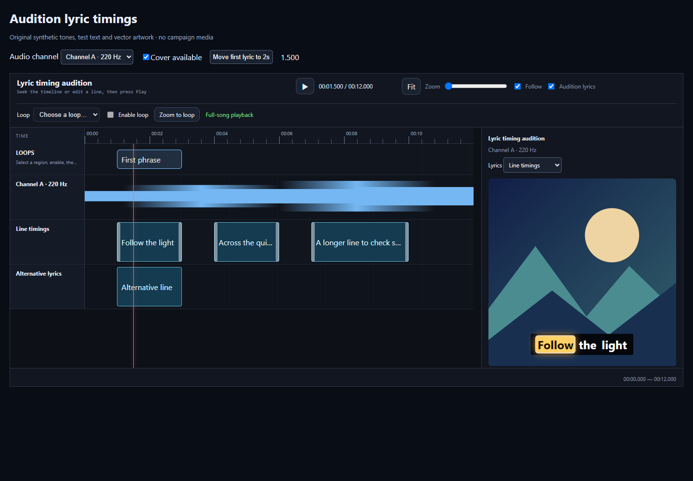
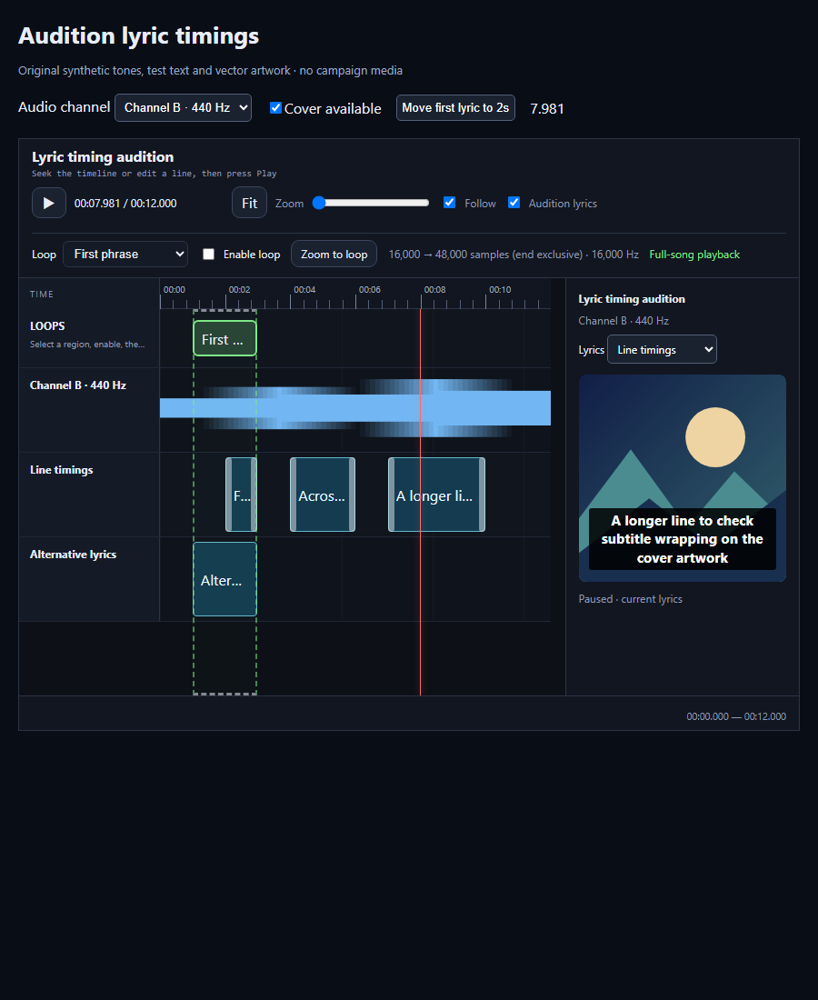
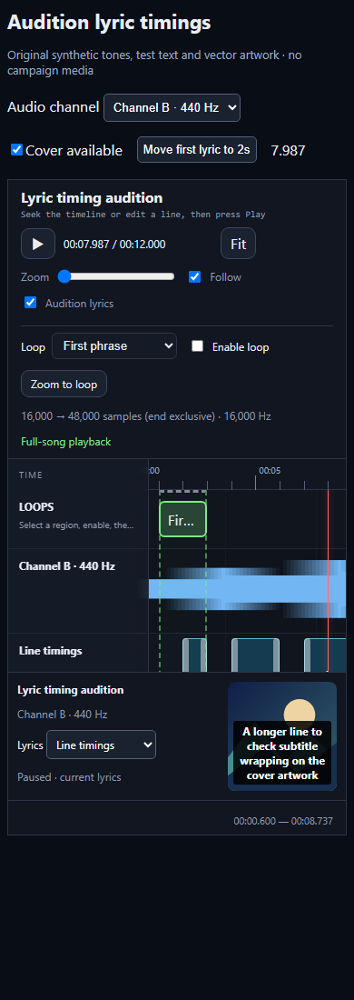

# Lyric timing audition

The preview paints the active lyric lines as subtitles over the supplied cover
and highlights the word under the playhead when per-word timing is supplied.
It consumes the same source time as the timeline playhead. Play, Pause, timeline
seeks, buffered loop repeats and live timing edits therefore share one transport.
Showing or hiding the preview never starts playback or creates another player.



Actual standalone browser capture. The mountain cover is an original vector
illustration; the words and audio are synthetic test fixtures, not a song campaign.

## Connect a selected audio channel

```tsx
<TimelineSequence
  audioSrc={selectedChannel.url}
  duration={sourceDuration}
  lanes={lanes}
  lyricAudition={{
    artworkSrc: coverUrl,
    artworkAlt: "Description of the song cover",
    audioLabel: selectedChannel.name,
    items: lyricLines,
    words: lyricWords,
    enabledByDefault: true,
  }}
/>
```

The host's channel selector supplies `audioSrc` as usual. Source changes stop the
previous audio and reset the shared playhead; the preview then follows the new
source. No autoplay is introduced. Stem channels must have the same time origin
as their lyrics. For trimmed or offset audio the host must adapt lyric seconds
to that channel's source clock and supply matching loop sources; no alignment is
inferred from names, channel labels or duration.

`lyricAudition` is optional. Its fields are:

| Field | Behaviour |
| --- | --- |
| `artworkSrc` | URL of host-authorized cover artwork. Missing or failed artwork shows an unavailable message while timed text remains usable. |
| `artworkAlt` | Accessible image description; defaults to “Cover artwork”. |
| `audioLabel` | Optional React content identifying the selected `audioSrc`. |
| `laneId` | Exact `type:'timing', kind:'line'` lane ID. A missing pinned lane stays unavailable. |
| `items` | Optional readonly `{start, end?, label?}[]` in source seconds. Overrides lane selection. Use a host parser for LRC/SRT or legacy block lanes. |
| `words` | Optional readonly `{start, end, label?, lineId?}[]` in source seconds. The active `[start,end)` word is highlighted while the complete line remains visible. Use `lineId` for overlapping vocal lines. |
| `enabledByDefault` | Initial state of the Audition lyrics checkbox; defaults to true. The visitor's toggle is retained when the source changes. |

When neither `items` nor `laneId` is supplied, the first line timing lane is used.
With several line lanes, a selector chooses which to audition. Word, cue and
keyframe lanes are never implicitly treated as lyric lines. Updated lane items
are rendered immediately; the preview never modifies or saves timings.
`TIMELINE_LYRIC_AUDITION_API_VERSION` is `2` for the active-word contract.

## Subtitle boundaries and appearance

Intervals are start-inclusive and end-exclusive. Explicit ends preserve silence
between phrases. A line without an end runs to the next distinct start or the
known audio duration; an empty label can clear start-only LRC lyrics. The last
start-only line remains unavailable until duration is known. Invalid negative,
non-finite or reversed bounds are ignored. Overlapping lines appear together;
the compiler sorts a copy of the data, preserving the host's input.

Text is escaped by React, wraps within the cover, and keeps embedded newlines.
Timed words use start-inclusive, end-exclusive bounds. A boundary activates the
following word without a double highlight. Parallel lead and backing lines keep
separate word sets when their `lineId` values differ. Line-only callers retain
whole-line rendering; the component does not split text or invent word timing.
The cover uses `object-fit:contain` without cropping. Subtitle text is white over
a dark backing and has no animation or automatic screen-reader announcements.
Use the host's intentionally chosen font through `--rts-subtitle-font` as needed.
Customize the active state through `--rts-audition-active-text`,
`--rts-audition-active-bg` and `--rts-audition-active-glow`. Forced-colour mode
uses the visitor's system highlight colours.
No font download or campaign typography change is performed by this component.



Tablet capture at 900 CSS pixels, with a long synthetic line.



Phone capture at 390 CSS pixels. The cover preview moves below the timeline.

## Reproduce and verify

From a source checkout:

```sh
npm ci --ignore-scripts
npm run demo:lyrics
```

Open `/examples/lyric-audition/` on the loopback server. Choose Channel A or B,
click the waveform to seek, press Play, edit a line or select the phrase loop.
The demo generates 220/440 Hz WAV tones locally and releases its Blob URLs on
unmount. Its original SVG cover, test text and code are covered by this repository's
MIT licence. It makes no external media requests.

[Play the actual silent UI recording](media/lyric-audition-demo.webm).
Playback is user-controlled. Transcript: seek into the first line; play through
the gap; pause and seek backward; move the first lyric boundary; choose another
lyric lane and audio channel; repeat a buffered phrase loop; hide/show the preview;
remove/restore the cover; inspect tablet and phone layouts; play to the source end.
The recording has no audio track; technical audio advancement is checked separately.
Initial empty page-load frames have been trimmed from this checked demonstration.

Run `npm run typecheck`, `npm test`, and `npm run build` for regression coverage.
For actual browser playback and fresh captures, install Python Playwright with a
compatible browser, start the demo, then run:

```sh
python scripts/check-lyric-audition.py --browser /path/to/chromium
```

The bounded check captures screenshots and raw video, validates play/pause/seek,
timing edits, line-lane choice, selected source changes, loop wrap, toggle and
missing artwork, long-line responsive layout and source end. It closes its page,
context and browser in `finally` and writes a private receipt under the ignored
`.release-test/`. The browser capture is evidence of the fixture UI; it does not
establish subjective listening quality, a real song's timing accuracy or adoption
by any consuming application.
Inspect and trim any initial page-load frames in a new raw recording before
replacing the documentation video; verify its first decoded frame and playback.

## Potential problems

- **No timed lyrics available:** supply a valid line lane or explicit `items`;
  check a pinned `laneId` still exists and that the final inferred end has a
  finite source duration. The preview does not parse timing files or substitute
  another lane for a missing pinned source.
- **Lyrics do not match a channel:** verify the selected recording, time origin
  and any excerpt offsets in the host adapter. The preview cannot establish a
  recording's provenance or repair its timings.
- **Artwork unavailable:** check the host URL and normal image permissions. The
  subtitle audition remains usable; no artwork is fetched from another service.
- **Windows dev server exits during browser QA:** isolated browser profiles can
  hold temporary files open. The demo's Vite watcher excludes `.release-test/`,
  capture media and model caches; retain those exclusions when adapting the demo.
